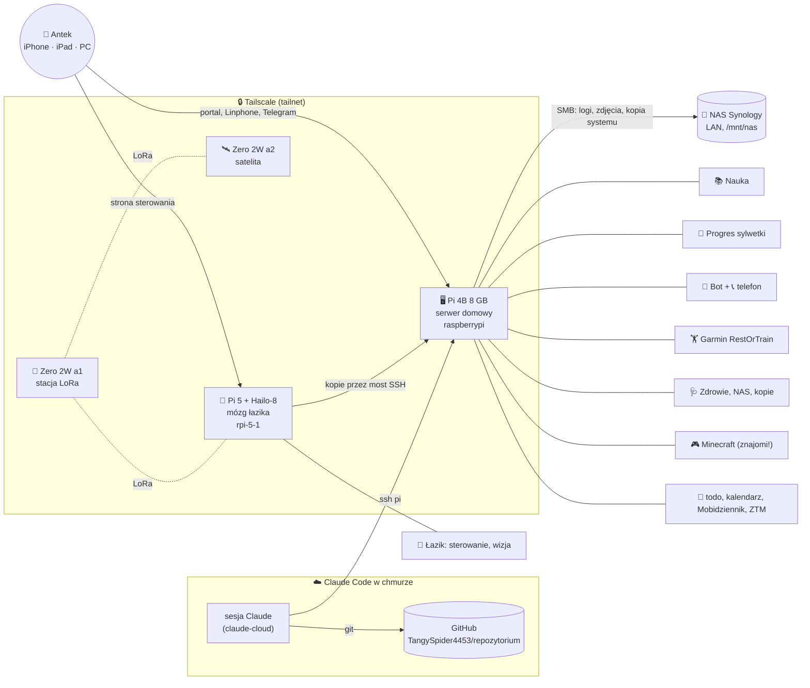

# 🧠 MAPA — mózg Claude

**Start każdej sesji tutaj.** Ta mapa mówi, co istnieje, jak się łączy i gdzie szukać szczegółów.
Repo jest **publiczne** → zero haseł, kluczy, kodów, publicznego IP domu i nazwisk (zasady: [zasady.md](zasady.md)).

## 1. Jak myśleć (pętla każdej sesji)
1. Przeczytaj tę mapę → [zasady.md](zasady.md) → plik z obszaru, którego dotyczy prośba (tabela w punkcie 3).
2. Połącz się z Pi ([dostep.md](dostep.md)) i **sprawdź stan, zanim coś zmienisz** (repo bywa nieaktualne).
3. Zrób zadanie. Przed wgraniem pliku na Pi porównaj md5 kopii z Pi i z gita.
4. Na koniec: dopisz [sesje.md](sesje.md), popraw [do-zrobienia.md](do-zrobienia.md), nowe ustalenia →
   [decyzje.md](decyzje.md) / [uzytkownik.md](uzytkownik.md), zmienione fakty → popraw węzeł (nie dopisuj sprzecznych).

## 2. Mapa świata

## 3. Gdzie szukać (router)

| Pytanie / zadanie dotyczy… | Węzeł pamięci | Pełna dokumentacja |
|---|---|---|
| czego nie wolno, zgody | [zasady.md](zasady.md) | — |
| kim jest użytkownik, styl pracy | [uzytkownik.md](uzytkownik.md) | — |
| sprzęt, adresy, sieć | [urzadzenia.md](urzadzenia.md) | `SERWER.md` |
| usługi i timery na Pi 4, co działa teraz | [uslugi.md](uslugi.md) | `SERWER.md` |
| projekty: stan, pliki, problemy | [projekty.md](projekty.md) | `PLAN.md`, `PROGRES.md`, `lazik/LAZIK.md` |
| gałęzie repo, co jest gdzie | [repo.md](repo.md) | — |
| łączenie z Pi, klucze (bez wartości) | [dostep.md](dostep.md) | `PLAN.md` §4 |
| co zostało do zrobienia | [do-zrobienia.md](do-zrobienia.md) | `PRZEKAZANIE.md` w kopiach |
| dlaczego coś jest tak, a nie inaczej | [decyzje.md](decyzje.md) | dzienniki w `SERWER.md`, `PLAN.md` §9 |
| co robiły poprzednie sesje | [sesje.md](sesje.md) | kopie rozmów na Pi (niżej) |

## 4. Źródła poza repo
- **Kopie rozmów ze starego konta Claude** (na Pi): `~/Desktop/dla claude kopie zapasowe/`
  - `Serwerek/` — serwer, nauka, bot, telefon, Garmin (19.10–16.11): `PRZEKAZANIE.md`, `zapis_rozmowy.md` (450 KB).
  - `Łazik - sterowanie, wizja, kopie (konto 1)/` — łazik (26.10–16.11): `PRZEKAZANIE.md`, `zapis_rozmowy.md`, kod.
  - `DOSTEP_PRYWATNE.md` w obu = hasła. **Nie czytaj bez potrzeby, nigdy nie kopiuj do repo ani na czat.**
- Dane na Pi: `~/portal/dane/` (postępy, zdrowie, progres), NAS `Tony-Folder/Raspberry/`.
