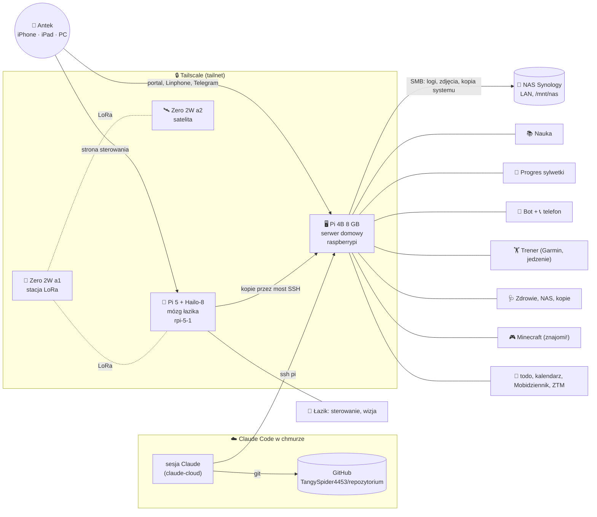

# Infrastruktura: urządzenia, dostęp, repo

Czytaj, gdy: łączenie z Pi/Tailscale nie działa, pytanie o adresy, sprzęt, gałęzie repo.

## Urządzenia i sieć

| Urządzenie | Rola | Tailscale | Inne |
|---|---|---|---|
| **Raspberry Pi 4B 8 GB** | serwer domowy: portal, bot, telefon, NAS-kopie, Minecraft | `raspberrypi` 100.108.241.58 | LAN eth0 172.23.0.20, wlan0 .24; Debian 13 aarch64, user `tonyg`, sudo bez hasła, karta 58 GB |
| **Raspberry Pi 5 8 GB + AI HAT+ Hailo-8** | mózg łazika | `rpi-5-1` 100.64.96.61 | LAN 172.23.0.15, user `rpi`, ekran HDMI 1024×600 |
| Pi Zero 2W **a1** | stacja LoRa | `rpi-zero2w-a1` | user `rpi` |
| Pi Zero 2W **a2** | satelita LoRa | `rpi-zero2w-a2` | user `rpi` |
| **NAS Synology DSM 7** | kopie, zdjęcia, logi | — | 172.23.0.28, udział `Tony-Folder` → `/mnt/nas` na Pi 4 (960 GB, 16% zajęte 17.11) |
| iPhone 14 Pro, iPad, PC Windows | Antek | `iphone-14-pro`, `ipad157`, `desktop-lgevlh8` | |
| `pc-antek` | komputer Antka (Windows) | `pc-antek` | |
| `claude-cloud` | sesja Claude w chmurze | efemeryczny | |

Łazik — sprzęt (kamera C170, L298N, MPU6050, BME280, LoRa DX-LR03): `lazik/LAZIK.md`.

## Dostęp (bez sekretów)

### GitHub
- Repo `TangySpider4453/repozytorium`, konto GitHub połączone z Claude (2026-11-17).

### Raspberry Pi przez Tailscale (sesja w chmurze)
- Hook `.claude/hooks/session-start.sh` instaluje Tailscale, ustawia alias `ssh pi` i łączy kluczem ze zmiennej
  środowiska **`TS_AUTHKEY`** (ustawia ją użytkownik w ustawieniach środowiska Claude; klucz nigdy w repo ani na czacie).
- Środowisko potrzebuje dostępu do sieci Tailscale (`*.tailscale.com`, serwery DERP). Przy dostępie „Limited” bez tych
  hostów wszystko kończy się 403 z proxy. Od 2026-11-17 środowisko „Default” ma pełny dostęp do sieci i zmienną `TS_AUTHKEY`.
- Sprawdzenie: `tailscale status`, `ssh pi hostname`. SSH na Pi jest w trybie „check”: przy pierwszym połączeniu podaj
  użytkownikowi link `login.tailscale.com/a/...` do zatwierdzenia (wygasa po kilku minutach).
- **Bez klucza w sesji** (np. zmienna dodana dopiero w trakcie): `tailscaled --tun=userspace-networking
  --state=/var/lib/tailscale-claude.state ...`, potem `tailscale up --hostname=claude-cloud --accept-dns=false` wypisze
  link logowania; użytkownik klika i zatwierdza (zadziałało 2026-11-17, SSH od razu bez „check”).
- Gdy `tailscaled` padnie: uruchom ponownie z tym samym `--state`, klucz niepotrzebny.
- Pełny opis: `PLAN.md`, sekcja 4 („Sesja w chmurze a Pi”).

### Bez Tailscale
- Przygotuj pliki w repo; wgranie na Pi zrobi sesja na komputerze użytkownika albo on sam przez Sambę
  `\\100.108.241.58\tonyg`. Powiedz mu wprost, że trzeba jeszcze wgrać.

## Repozytorium i gałęzie

Repo `TangySpider4453/repozytorium` jest **publiczne**. Gałąź domyślna nazywa się `TangySpider4453`.

**Od 2026-11-17 wszystko jest na gałęzi domyślnej** (scalone: `claude/nauka-z-claude` + `lazik-mapa` + `claude/pamiec`).
Pracuj na niej albo na krótkiej gałęzi `claude/…`, którą od razu scalasz. Nie zostawiaj pracy na bocznych gałęziach,
bo następna sesja jej nie zobaczy.

| Katalog | Co |
|---|---|
| `pamiec/` | mózg Claude |
| `strona/`, `narzedzia/` | Nauka (kopie z Pi `~/portal/sites/nauka/`) |
| `progres/` | Progres sylwetki |
| `pi/` | kopie kodu z Pi 4: `app.py` (portal), `bot/`, `glos/`, `nas/`, `airplay/`… |
| `zdrowie/`, `automatyczne/`, `kalendarz/`, `todo/`, `mobi/`, `silownia/`, `komunikacja/`, `budziki/`, `glosnik/`, `wspolne/` | strony portalu |
| `lazik/` | łazik: apki Pi 5, kopie, strony |
| `.claude/hooks/session-start.sh` | start sesji: Tailscale, `ssh pi`, wypisuje stan |

Stare gałęzie (`claude/nauka-z-claude`, `lazik-mapa`, `claude/pamiec`, `claude/ssh-raspberry-pi-connection-bwphfl`) są
już scalone albo nieistotne i można je usunąć.

## Mapa świata

## Dziennik
- 2026-11-22: pamięć podzielona na tematy (`pamiec/tematy/`); start czyta tylko MAPA + zasady (~4 KB zamiast całego folderu ~50 KB). Stare pliki w `archiwum/`.
